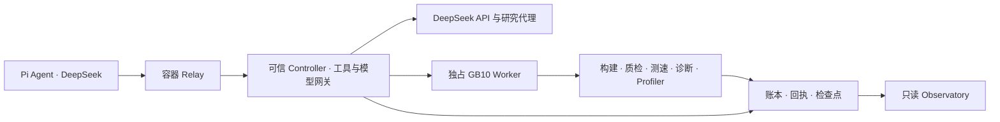

# Gemini 交接 · EvolveEngine Level 3 切换到原版 BF16

更新于 2026-11-26。接手入口为本仓库 `main`。当前工程轨迹使用 Spark-X2.6-1.7B GGUF Q8_0，已在段末暂停。接下来的目标是用同一模型的原版 BF16 检查点建立独立的基线和探索轨迹。控制器、Harness、可信 Worker、评测框架和看板可以复用。新的模型资产、数值参考、Worker 准入和性能曲线各自登记。

## 先从这里接手

1. 读本页和 Level 3 当前开发门禁，跑下方的离线检查。`b6d088e` 保留实机过程中整理出的运行修复，`762fb64` 增加宿主容错。看板独立补测投影也已纳入 `main`。这两个提交整合了独立 worktree 的代码。SSH 连接继续从可信宿主的环境中读入。 [开发门禁](experiments/spark26_gguf/level3/DEVELOPMENT-GATES.md)
2. 优先完成版本化 BF16 模型资产、原生加载和部署分支。先核实权重清单、共享权重和 MTP/nextn，随后在独占 GB10 上做短生成。硬化后的真实 Worker 冒烟可以和新的准入工作一起准备。
3. 用 BF16 E0 重建数值与测速参考，签发新 Worker 准入后启动一条独立工程轨迹。正式 W、B0/B2 和最终 Q/T 继续使用各自的登记与证据链。实验材料与凭据通过既有的本地或受控存储交接。

## 整体运行结构



- Agent 自己选择 Engine 和 Harness 的改动、研究与迭代顺序。Engine、激活的 Harness、已验证事实和显式保存的 WIP 可跨段继承。Controller 持有授权与账本，Worker 决定回执的正确性、隔离与性能状态，Agent 负责提名。正常换段与异常恢复分别记录，恢复使用已验证的检查点。
- 现有 `objective-exploration.json` 是 Q8_0 自由探索模板。DeepSeek Flash Max 的模型配置、累计预算策略和外层记账与目标引擎精度相互独立。探索继续保留完整的 API Token/费用、墙钟、节点占用和各 GPU 作业时间。新 BF16 模板应绑定新的资产与策略标识。 [自由探索配置](experiments/spark26_gguf/level3/objective-exploration.json)
- 现有外部研究模式 `deepseek_open_v1` 会在启动时把系统提示改为允许读当前上游代码。历史补充协议选择 E0 时间边界。BF16 新登记前应按项目负责人已选的边界处理，把实际出站配置和 Broker 过滤与登记对齐，覆盖搜索摘要、重定向、版本不明和镜像来源。研究复用保留 URL、版本、许可证与归因。 [启动器](experiments/spark26_gguf/level3/launch_live.py) · [补充协议](experiments/spark26_gguf/level3/PROTOCOL-ADDENDUM-v1.md)
- 运行拓扑是开发机上的 Controller/Pi、独立 GB10 Worker、另一台 Linux 主机上的看板。保持 Worker 独占与统一 GPU 锁，可信 Controller 通过 `EE_L3_WORKER_SSH_HOST`、`EE_L3_WORKER_SSH_USER` 和 `EE_L3_WORKER_SSH_ED25519` 绑定目标和主机指纹。认证凭据通过既有操作员渠道提供。负责测速的节点只承担实验所需负载。 [实机入口](experiments/spark26_gguf/level3/node_preflight.py) · [看板部署](observatory/README.md)

## 源码导航

| 领域 | 接手入口与职责 |
| --- | --- |
| 研究设计 | [V3 设计](研究方案/07%20框架%20v3%20设计.md) · [Level 3 最终方案](研究方案/09%20Level3%20自由探索最终方案.md) · [Level 3 实施登记](experiments/spark26_gguf/level3/README.md) · [开发门禁](experiments/spark26_gguf/level3/DEVELOPMENT-GATES.md) |
| 启动与会话 | [launch_live.py](experiments/spark26_gguf/level3/launch_live.py) 校验启动计划、实现哈希和 Worker 清单，渲染提示并组装可信运行。 [v3_level3_run.py](evolveengine/v3_level3_run.py) 管理开发工具、后台作业、换段、暂停、恢复和提名。 [v3_level3_lifecycle.py](evolveengine/v3_level3_lifecycle.py) 管理带证据绑定的版本和检查点。 |
| 模型与隔离 | [v3_runner.py](evolveengine/v3_runner.py) 实现网关和容错审计。 [v3_relay.py](evolveengine/v3_relay.py) 桥接容器通道。 [v3_provider.py](evolveengine/v3_provider.py) 管理模型请求、预留和结算。 [v3_level3_guest.py](evolveengine/v3_level3_guest.py) 管理 Pi 隔离与存活检查。 [v3_context_control.py](evolveengine/v3_context_control.py) 管理上下文窗口。 |
| 源码、构建与部署 | [prepare_source.py](experiments/spark26_gguf/level3/prepare_source.py) 当前生成带 GGUF overlay 的源码树。 [v3_level3_source.py](evolveengine/v3_level3_source.py) 校验源码包与候选路径。 [v3_level3_build.py](evolveengine/v3_level3_build.py) 构建 Native 产物。 [v3_level3_deploy.py](evolveengine/v3_level3_deploy.py) 绑定镜像、部署产物、模型和实际参数。 [v3_level3_startup.py](evolveengine/v3_level3_startup.py) 管理候选可声明的运行参数。 |
| Worker 与准入 | [worker_stdio.py](experiments/spark26_gguf/level3/worker_stdio.py) 是远端执行入口。 [node_preflight.py](experiments/spark26_gguf/level3/node_preflight.py) 检查节点、模型与镜像。 [qualify_split_worker.py](experiments/spark26_gguf/level3/qualify_split_worker.py) 运行准入正负控。 [v3_level3_worker_channel.py](evolveengine/v3_level3_worker_channel.py) 与 [v3_level3_worker_ssh.py](evolveengine/v3_level3_worker_ssh.py) 验证链路、租约和收尾。 |
| 质量与性能 | [live_split_quality.py](experiments/spark26_gguf/level3/live_split_quality.py) 组织两臂隔离和绝对轨迹。 [v3_level3_trajectory.py](evolveengine/v3_level3_trajectory.py)、[v3_level3_eos.py](evolveengine/v3_level3_eos.py) 和 [v3_level3_sampling.py](evolveengine/v3_level3_sampling.py) 实施各质量判据。 [v3_level3_chat_timing.py](evolveengine/v3_level3_chat_timing.py) 组织真实文本配对。 [v3_level3_scoring.py](evolveengine/v3_level3_scoring.py) 定义配对检查、门槛和加权得分。 |
| 审计、研究与交付 | [权重审计协议](experiments/spark26_gguf/level3/WEIGHT-AUDIT.md) · [v3_level3_weight_audit.py](evolveengine/v3_level3_weight_audit.py) · [v3_level3_delivery.py](evolveengine/v3_level3_delivery.py) · [v3_level3_holdout.py](evolveengine/v3_level3_holdout.py) · [v3_level3_web_research.py](evolveengine/v3_level3_web_research.py) |
| 看板 | [observatory_data.py](evolveengine/observatory_data.py) 对可信回执做白名单投影。 [observatory.py](evolveengine/observatory.py) 提供快照和 SSE。 [observatory_publish.py](evolveengine/observatory_publish.py) 原子发布。 [main.tsx](observatory/src/main.tsx) 展示曲线、历史和证据。 |

## 已完成的工程工作与验证范围

- Q8_0 工程轨迹已证明 ARM64 Native 冷构建、组件增量构建和产物复用、两种 CUDA Graph、真实文本配对计时以及可信 Worker 开发门禁可以在实机路径运行。若要确认某一次增量质量或计时实际载入哪个产物，应同时核对构建回执、组件更新、部署清单和实际加载身份。单独的复用回执只签收该次复用。已登记的冷构建和正负控仍可作为 BF16 工程工作的脚手架。 [开发门禁](experiments/spark26_gguf/level3/DEVELOPMENT-GATES.md)
- 第二版 Q8_0 候选有可信 Worker 独立补测，通过五项开发质检。其单组配对结果在权重审计前保持暂定。看板把该证据显示为 `Independent Replay`，保留原 Controller 账本，独立点使用测量顺序作横轴，页面显示段末暂停。第二版的补测报告、检查点和结算在受控运行目录保管。Q8_0 内核补丁只作为历史实验资产，迁移时先提炼通用的研究、测试与构建经验。
- `762fb64` 的 RPC 容错把异常映射为脱敏错误，同一 Relay 可以处理下一条调用。内部 `rpc-segment-NNN.jsonl` 包含操作、耗时和后台结算等宿主审计数据。后台异常会结束对应作业状态。Profiler 从 `GRAPH_PROFILES` 读取允许的档位。
- Pi 监视 Relay 和工具回复。Relay 中断，或单个工具 360 秒未回复且无真实 Worker 作业在途，会结束该 Pi。恢复要求清理、Worker 状态、模型用量和检查点均有证据支持。宿主回调无法排空时写 `runtime-quarantine.json` 停机对账。已验证的是离线故障注入与宿主路由，真实新版 Worker 冒烟仍待执行。 [实施登记](experiments/spark26_gguf/level3/README.md) · [故障回归](tests/test_v3_level3_runtime_hardening.py)
- 看板可信操作员可在运行根旁提供 `<run-directory-name>.observatory-operator.json`。投影要求 schema 为 `ee-observatory-operator-v1`，并绑定 Run ID、批准 SHA-256、已登记候选和 E0。处理器校验五项开发质检、四场景比值和重新计算的加权分数，按计时回执去重。看板只接收白名单字段。 [投影源码](evolveengine/observatory_data.py) · [回归测试](tests/test_observatory.py)

## BF16 迁移和验收

### 1. 原生加载与目标资产

- 固定 SGLang 源码提交 `b2ce7f8811bc40fd0d67000030c22edbbe0f2a37`。旧 Q8_0 通过兼容 overlay 加载，本次从同一提交的原生 `Spark2_5ForCausalLM` 路径起步。以短生成、加载日志和运行时核对确认兼容性。若需要兼容补丁，登记其 diff、产物哈希和必要性。 [历史兼容层](experiments/spark26_gguf/README.md) · [模型部署](evolveengine/v3_level3_deploy.py)
- 从授权的原版检查点获得分片及索引、config、tokenizer、chat template 和有用的生成配置。登记逐文件 SHA-256、字节数和模型来源，检查 safetensors header 的键、dtype、形状和张量清单。用原生加载路径核对 Embedding/lm_head 是否真的共享、显式 head 的处理，以及 fused QKV、特殊 Token、引擎有效 dtype 和 EOS。实机短生成是这一步的完成证据。
- 从索引和实际加载器同时核实是否存在 MTP/nextn 权重及对应架构。自带权重的存在和可调用性都需验证。新增外部 Drafter 资产按协议登记。GEMV、lm_head、Graph、调度、融合和合规投机解码都是可测试方向，具体收益交由配对测量。
- `ServiceSpec`、模型文件暂存与只读挂载、Docker 参数、启动器的计划/提示、Worker 预检和租约须共同识别 BF16 资产。沿用已锁定的镜像/Native 构建链时，先核对 ABI 和实际导入来源。用新的精度与审计策略 ID 做登记，同时让历史 Q8_0 路径继续可重放。 [模型部署](evolveengine/v3_level3_deploy.py) · [Worker 预检](experiments/spark26_gguf/level3/node_preflight.py)

### 2. 权重与 KV 契约

- Target 计算以原始 BF16 权重为准。允许可逐项还原的 BF16 无损布局、正常算术中的临时转换和 FP32 累加。跨算子或请求持久保存 FP8、INT8、FP4 或其他非 BF16 权重副本，含部分层与 lm_head，属于违规。把规则同步写入提示、Worker 观测及外部权重审计的证据格式。
- E0 与候选先以 BF16 KV Cache 准备。把有效 KV dtype 写进登记与加载回执，等负责人确认现网和实验口径后固定。若要改变 KV 精度，在对应实验方案中重新登记。
- 显存峰值、常驻显存与对 E0 的差值均保留为观测，实际节点容量与 OOM 防护继续生效。对历史最佳、检查点和最终提名自动留证，由可信人员异步复核。最终交付须完成权重审计。带宽检查使用实际唯一权重读取量、可复用布局、有效带宽和已接受的投机 Token 解释异常 TPOT，作为审计提示。 [历史权重审计协议](experiments/spark26_gguf/level3/WEIGHT-AUDIT.md)

### 3. 重做基线、控制与验收

| 交付 | 最低验收证据 |
| --- | --- |
| BF16 E0 与运行配置 | 独立部署原版权重并短生成。启用并验证 Decode 和 Prefill CUDA Graph，保留已证明可解析的流式配置。记录 TP、attention、KV、Radix、并发与实际捕获日志。生产等效性由脱敏的上线配置、模型身份和负载登记支持。 [生产登记模板](experiments/spark26_gguf/PRODUCTION_READONLY_INTAKE.md) |
| 数值参考和开发质量 | 以 BF16 E0 重建参考和容差。取消隔离仍是同引擎、冷缓存两臂的比较，绝对数值由候选相对独立 E0 参考判断。保留自然 EOS、长轨迹、全文表分布与采样设计。共享前缀上的 Decode 对比可作为影子审计。 |
| 计时负载与噪声 | 冻结真实文本及预筛选，配对两臂使用同一组按计划变更的输入。按登记做独立 E0/E0 交替配对，重算四场景噪声、不退化门槛和 W1/W2 精度。旧权重或门槛若用于新协议，先登记其适用性。开发加权分数、正式 W 和外部基线各自使用对应证据。 |
| 可信正负控 | 以合法 BF16 GEMV/归约顺序或无损布局作正控，以 Native 数值破坏作负控，另用低精度常驻副本作为权重审计负控。复用输出记忆化、请求隔离和不安全编译选项的工装框架，验证实际效果与加载身份。 |
| Worker 准入和冒烟 | 更新实现哈希、镜像、源包、资产、控制证据、租约和启动计划。记录 BF16 冷构建与至少一种增量构建的时间、部署身份和清理结果。把 `operation_smoke.py` 的真实宿主入口接到一次性已准入工程上下文，补 Worker 实机证据。 |
| 新探索和最终评估 | 新 Run ID 和 BF16 曲线从新 E0 起算，记录基础设施版本、暂停和恢复。最终 Q 含下游任务质量检查，Q/T 留出由用户和其指定的强模型共审，保持独立审批与启封。 |

### 4. 仍待核实的输入

- 原版 BF16 检查点的授权存放位置、分片清单、实际 dtype，以及加载器能否完整消费张量。
- 现网的权重与 KV Cache 实际精度、上下文、两种 Graph、attention、调度与投机设置。收集脱敏部署记录即可开始核对。
- MTP/nextn 是否在这份检查点内，是否可由锁定的 SGLang 启用。先查权重键和配置，再决定是否做投机对照。

## 从干净检出验证

在仓库根使用项目所需的 Python 测试依赖。相关测试组需要 NumPy。树中可用的 Pi/Docker 环境决定部分测试是否跳过。

```sh
python -m unittest discover -s tests
python experiments/spark26_gguf/level3/operation_smoke.py
npm --prefix observatory ci
npm --prefix observatory run build
```

`operation_smoke.py` 直接执行时使用离线替身，覆盖 11 项宿主操作的正例与错误输入。真实准入依据新计划生成，可信入口会重新检查控制器和 Worker 实现字节。运行中出现 `runtime-quarantine.json` 时先核对旧 Controller、Worker 作业与费用，再判断能否继续。 [启动器](experiments/spark26_gguf/level3/launch_live.py) · [准入检查](experiments/spark26_gguf/level3/qualify_split_worker.py)
