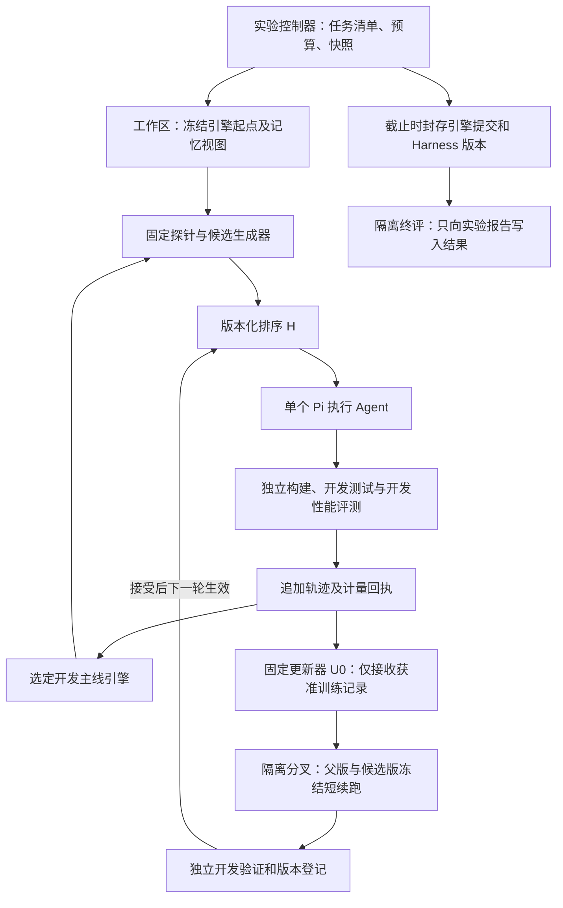

# Harness 架构与更新机制

> **v1 文档。** 当前 RQ-A 的研究问题、取点和判据见 [05 框架 v2 设计](./05%20%E6%A1%86%E6%9E%B6%20v2%20%E8%AE%BE%E8%AE%A1.md) §8。旧报告仍按本版解释；修改协议只在本 Git 目录进行。

一次预算只够尝试少数优化时，先做哪个候选会决定最后交付什么引擎。本方案把这个决策提取为可替换函数 `rank(observation, candidates)`。单个 Pi Coding Agent 负责实现选中的优化，独立控制器负责计量、验证和保存结果。首版只允许系统自动修订排序函数。前后两版在同一起点收到相同候选时，可以逐项解释第一次动作为什么改变。

研究范围见 [00 研究总方案](./00%20%E7%A0%94%E7%A9%B6%E6%80%BB%E6%96%B9%E6%A1%88.md)。数据分区、更新机会、检验次数、成本口径、门禁阈值和正式比较规则以 [02 实验协议与判定规则](./02%20%E5%AE%9E%E9%AA%8C%E5%8D%8F%E8%AE%AE%E4%B8%8E%E5%88%A4%E5%AE%9A%E8%A7%84%E5%88%99.md) 为准。下文中的名称是本项目拟实现的接口，示例描述预期行为。

## 1. 一次运行由谁控制



| 组件 | 读取与写入权限 | 冻结点 |
|---|---|---|
| 实验控制器 | 持有任务与硬件清单，发放资源租约，写入账单、检查点、引擎与 Harness 两套版本指针 | 实验开始前冻结控制程序、预算规则和时钟语义。执行 Agent 无写权限 |
| 开发工具与候选生成器 | 从当前引擎采集 profile，用统一模板、模型参数、工具清单与上下文生成候选描述 | 两组共享能力。模板、分类、代价分档、去重和过滤逻辑固定 |
| 排序器 `H` | 读取归一化的开发观测及候选特征，只返回候选 ID 的一个排列 | 唯一可写策略产物是受约束的排序规则。必须通过登记与验证后才能装载 |
| Pi 执行适配器 | 只在当前引擎沙箱内读代码、改动授权目录、编译和发起开发测试。将补丁及原始观测交回控制器 | 固定模型版本、模型参数、系统指令、上下文压缩设置和工具权限。SDK 或 RPC 接入细节由适配器封装 |
| 经验库 `M` 与轨迹库 | 控制器保管完整历史。冻结的检索器按实验分组向 Agent 释放开发摘要 | 定版检索器、摘要模板、窗口与截断规则。关闭默认跨运行会话恢复、个人记忆和未登记的缓存 |
| 更新器 `U0` | 读取父策略和允许的训练轨迹，写入候选规则、修改依据、预期行为变化 | 更新提示、生成器、解释器、触发条件、候选上限与晋级逻辑均冻结 |
| 评测服务 | 从不可变快照重建引擎。独立保存正确性、质量、完整性与实测性能回执 | 测试程序、模型权重、工作负载及评分逻辑使用只读版本。封存样本、答案与逐请求分数不进入训练轨迹 |

沙箱和验证服务使用分离的工作目录与身份。执行 Agent 提交的是相对于已知父快照的源码补丁，评测服务只将允许路径上的修改应用到干净基线。Agent 可以选择怎样实现已选候选，遇到不可实现的候选则返回原因。偷偷换一个优化方向会破坏动作归因，控制器把范围不符的提交记为协议偏离，保留原补丁供复核。

**跨会话究竟继承哪些经验。** 每次尝试保存一条结构化记录，包含父引擎、候选及动作标签、当时的瓶颈观测、实际改动、质量结果、开发侧配对吞吐差、失败阶段和资源消耗；每个数值链接到原始回执。首轮采用固定检索：先取同瓶颈类的最近记录，再按时间倒序补齐，按记录 ID 去重，至多 4 条、合计 1,200 个输入 token。截断顺序预先固定，优先保留动作、质量、性能和失败原因。两个实验臂使用同一规则，成功与失败均可被检索。交付的引擎源码单独继承。在关闭跨会话记忆的消融中移除这些记录和历史报告，两个策略仍看到同一引擎、当前 profile 和本会话的新观测。

## 2. 可以复现的 H0 与最小修改面

1. **先测当前引擎。** 对每个新的父引擎快照，固定探针先测开发基线，再采 profile，记录工作负载相位、GPU 活跃时间、CPU 提交或同步等待等可取得的观测及其采集条件。探针输出带有缺失标记。缺少关键计数器时，瓶颈类别取 `unknown`，不可填作零。已有相同环境与父快照的观测按事先统一的缓存规则复用。
2. **冻结这一步的候选池。** 每个候选包含优先解决的瓶颈类别、代码区域、具体假设、预期信号、估算成本档及固定次序。不兼容改动与同一父节点已判无效的完全相同候选由公共过滤器处理。列表、输入摘要、模型/模板版本及种子写入 `pool_digest`。排序器运行后不得追加临时选项。
3. **H0 的次序可由日志重算。** 先排与主要瓶颈类别相匹配的候选，再排其他候选。各档内依次按估算成本从低到高、预注册的候选次序和稳定候选 ID 排列。若类别为 `unknown`，跳过匹配项比较。控制器执行排序首位候选。池为空则按统一停止规则结束该节点探索，留下当时的过滤原因。
4. **H\* 只改变次序。** 一个策略版本由有限条具名特征条件、候选类别、优先级调整和固定的 H0 平局规则组成。实现使用只读规则表。匹配观测的规则按声明顺序把指定动作跨类提前（包括主类为 `unknown` 时），同档沿用 H0；未命中则完全保留 H0。输入特征限于登记的工作负载、profile 和候选元数据。输出必须覆盖输入池内全部 ID，且每个恰好一次。排序器不能读文件、发模型请求、添加候选或改写预算。策略包可保存规则、证据引用和说明，执行时只装载规则。空变更与在预注册回放窗内行为完全相同的更新记作 `no_change`。

候选 ID 仅用于关联和稳定平局，不提供给可学习的条件表达式。规则条件不得引用特定请求 ID、检查点哈希、任务答案、源码补丁或任意自由文本。这样清空外部记忆后仍可用确定性的输入重演排序，同时限制把旧任务答案塞进策略的可能性。

**候选池怎样落地。** 先导时每次让同一个 Worker 在独立的“提出候选”调用中给出至多 4 项具体改动，每项只填目标区域、预计影响的观测、动作标签、估计成本档和不可实施条件。公共模板同时给出当前 profile、当轮可读的历史和固定的成本分档说明，不透露当前加载的排序规则。控制器按父引擎、目标区域和标准化动作去重，核查可编辑范围，封存通过过滤的实际数量，再把池交给 H。生成器只给一项时照常运行，记为“此步无可排序空间”。固定的唯一实现调用接收选中项和原始证据，不能通过阅读另一臂的排序结果改变补丁。

**排除表不属于经验反馈。** 当前父引擎已经选过的 `(action_tag, 规范化 target_scope)` 是公共簿记格式，来源限于本臂继承的前缀与本臂后续尝试。关闭 Memory 仍向生成器提供相同口径的排除表，不含结果、收益、成本或尝试 ID；换父引擎时按新摘要查表。响应格式有效但过滤后没有候选时，仅在本步重提 1 次，沿用本次 profile 与排除表，区分抽取序号。两次生成分别按原上限预留；D/C 耦合前缀仍逻辑双记、物理一次。第二次仍空则停止，预算不足、格式错误和后端失败分别记账。生成回放每步只取最后一个真实冻结池，含空池；每次抽取及过滤原因另存。

示例中的 `host_launch_gap` 可以在 decode 窗口中用一个可审计的量分箱：按设备时间线求所有计算和拷贝流都空闲且下一次设备提交仍在等待主机的时间，占该窗口总时长的比例。CPU 提交与设备事件须能对齐，跨流重叠时间只算一次。无法对齐时记 `unknown` 并保存原始事件。在 E0 的先导观测上定高、低分界并冻结，另记 TPOT。这个值给排序器一项触发条件；“调度导致瓶颈”的解释仍需真实干预后观察间隙与端到端时延是否一起变化。

## 3. 模块契约与一次动作

| 接口 | 输入 | 输出与校验 |
|---|---|---|
| `open_run` | 公开任务、引擎父哈希、H 版本、记忆快照、环境与预算清单 | `run_id`、干净工作区和只读配置。拒绝哈希不匹配的输入 |
| `prepare_step` | 父引擎、当前轮记忆权限、公共生成种子、剩余预算 | 固定观测与有版本的候选池。内容相同的输入可按已登记规则回放 |
| `rank` | 已登记的观测特征和候选列表 | 排列及命中的规则编号。校验返回值是否为输入 ID 的排列 |
| `attempt` | `run_id`、父引擎、候选池及唯一选中 ID | 补丁哈希与父哈希，或结构化的失败/超时回执。两种结果都计费 |
| `evaluate_dev` | 补丁哈希、父哈希、公开评测配置 | 编译、正确性、质量、完整性、性能、资源和误差记录。失败阶段有明确状态 |
| `propose_update` | 父 H 哈希、获准的训练轨迹引用、冻结的 `U0` 配置 | 候选规则、相对父版的差异、修改证据、预期首选与失败条件 |
| `decide_update` | 候选和父版哈希、冻结分叉起点、两臂开发验证回执 | 接受/拒绝/证据不足及理由。只有接受且父版仍为当前版本时能推进 H 指针 |
| `seal_delivery` | 已登记的开发主线、截止回执及实验协议 | 封存待评引擎、H、预算与环境哈希。由终评服务独立重建并出报告 |

以下是一次假想的排序回放。两个候选都服务于 decode 主机侧开销，都已越过公共过滤。`host_launch_gap` 表示开发 profile 观察到的主机提交间隙，阈值与分箱方案在校准后冻结。

```json
{
  "observation": {"primary_class": "host_dispatch", "phase": "decode", "host_launch_gap": "high"},
  "pool": [
    {"id": "p", "class": "host_dispatch", "cost_band": "low", "action_tag": "pack_request_metadata"},
    {"id": "s", "class": "host_dispatch", "cost_band": "medium", "action_tag": "reduce_launch_gap"}
  ],
  "rule": {
    "when": {"primary_class": "host_dispatch", "phase": "decode", "host_launch_gap": "high"},
    "promote_action": "reduce_launch_gap"
  }
}
```

该输入对应的 H0 次序为 `["p","s"]`，候选版次序为 `["s","p"]`。H0 用成本区分同类候选，候选版结合细分观测与动作标签，先试有相应证据支持的方向。配套的 [04 候选策略回放.py](04%20候选策略回放.py) 可以直接读取这段 JSON。晋级证据来自真实引擎续跑。相同池是**同一状态的一步**可比条件。首次选中不同候选后，不论补丁是否被接纳，后续均按各臂自己的状态生成候选池。

## 4. 引擎主线、探索分支与恢复

| 状态与转移 | 控制器的动作与失败处理 |
|---|---|
| `READY → PROFILED → POOL_READY` | 获得租约并记录父引擎和环境指纹。公共基线、探针或生成器失败时，记录基础设施或生成失败类型，按固定重试规程恢复。已耗预算累计保留 |
| `POOL_READY → ATTEMPT → DEV_GATE` | 按排序试一个候选，在独立工作区生成补丁。编译、数值、输出质量、完整性依次检查，任何硬门禁失败即归档并结束本次尝试。性能测量使用已通过门禁的候选 |
| `DEV_GATE → ARCHIVED` | 所有尝试均有记录，包括令人失望的提速、负收益、OOM、未交补丁和最终无效的候选。性能落在噪声带内时按协议复测，资源不足则标记不确定 |
| `ARCHIVED → MAINLINE 或 EXPLORE` | 仅在父节点仍为主线、门禁通过、开发性能按协议可确认改善时推进主线。合法但不确定或暂时退化的分支单独归档。首轮两组均从在任主线选父节点。将来启用探索分支时，需重新验证相对于当前主线的完整补丁才可晋升 |
| `MAINLINE / EXPLORE → READY 或 SEALED` | 所有后续尝试记录实际父节点。截止后提交已选且有开发回执的主线。无改进时交付已验证的原始引擎。另存开发最佳、实际提交两字段，终评行随后由独立服务写入 |

**隔离分叉。** 策略晋级与后验比较各用临时分支。两臂从同一 `engine_digest + memory_digest + environment_digest` 启动，冻结 Harness。同选前缀由控制器执行一次、为两臂写回执；一旦首选分歧，不再共享实现或后续状态。两臂的 Agent 不能相互读取新代码、轨迹、缓存及报告。分叉内产生的引擎补丁只服务于该次验证，不能并回生产优化链。策略验证只改变可部署的 H 指针。这避免了给更新组两次额外搜索机会再取最佳引擎。平时的引擎探索分支与隔离验证使用不同 `branch_purpose`。

**断点与重试。** 记录先写不可变回执，再以父哈希比较并原子更新指针。使用 `(run_id, step_id, operation_id)` 给作业去重。重启时先查作业和计量状态，已成功的步骤恢复回执，已发生的工具调用与 GPU 时间保留原账单。已执行但记录缺失的操作记为不确定并核账。作业中断时保存最后合法主线，临时工作区不得替代它。环境漂移、设备故障与候选引起的崩溃分别编码，复跑与成对保留规则遵从 02。

## 5. U0 如何生成并筛选下一版

1. **在预注册机会自动触发。** 到达 02 规定的更新窗口，控制器先封存允许训练的轨迹范围和可用余额。若余额不足以完成候选生成与双臂验证，记录 `insufficient_budget` 并保留在任版本。失败候选、被选次数、实际成本、开发端到端增益、合法性及噪声带都进入摘要。没有被尝试的候选记为未观测。
2. **从反复出现的错误排序提出一条可检验修订。** `U0` 让固定生成器比较相同特征区间内的成功、失败与反例，提出受限的重排规则，列出受影响的动作、支持轨迹、潜在代价与预测。用排序器老是选中同类失败候选作为提案依据，但不把未执行候选当成已知赢家。
3. **静态检查与离线回放。** 在隔离解释器内检查模式、允许的字段、完整排列、确定性和对输入未被修改。用同一条已记录输入分别回放父版与候选版，保存首位发生变化的场景、未受影响的场景和反例。回放只检查行为能否按预期改变，不能用历史上缺失的反事实收益给候选打分。
4. **独立开发验证。** 控制器按 02 取此前未用于该提案的验证片段，从预先指定的同一点复制 E、M、代码、会话初始化方式与预算，固定两版 H 及更新器开关，执行等预算短续跑。记录相同起点的实际首次排序、双方后续尝试、独立开发门禁以及最终开发收益。所有提案、失败验证和对照续跑成本都记入更新组支出。独立科研用最终比较另按 02 记账。
5. **接受、拒绝或证据不足。** 正确性、质量、完整性与预算约束全部满足，且开发验证跨过预设收益与稳定性门槛，才发布不可变的新版本及其父哈希。硬门禁失败或证据不足时保留旧版并存档回执。验证顺序、次数及分区由控制器固定，更新器只收到协议允许的决议与摘要。封存终评结果不返回更新流程。后续若需回滚，记录指向历史已晋级版本的新部署事件，不覆盖版本谱系。

首版的更新器可以连续发布多个 H 版本，`U0` 自身始终冻结。要进一步检验更新器能否改进如何提出下一版，应另设实验固定初始 H、训练材料与元预算，比较两种更新器产生的新 H 的独立成绩。

## 6. 从行为到性能的反证实例

在固定 decode 任务的一批**假想**训练轨迹中，多次尝试减少请求元数据整理时间后，端到端 TPOT 仍在噪声带内。部分同类引擎状态的开发 profile 同时显示较长的主机提交间隙。`U0` 据此提出上面 JSON 所示规则，给针对提交间隙的候选更高顺位。H0 与候选版取得完全相同的细分观测和候选标签。

| 将要核对什么 | 怎样判读 |
|---|---|
| 回放中，有两个相关候选且条件命中时，首选是否从 `p` 变为 `s`？在条件未命中时是否保持原顺序？ | 命中后排序未变说明实现或规则无效。未命中状态也系统性变化，说明修改范围超过解释 |
| 同一起点续跑时，是否先实际尝试调度类改动？对应开发 trace 中提交等待及端到端 TPOT 是否同时改善？ | 等待缩短但 TPOT 未改善只支持局部机理。若获得收益却没有降低等待，则须保留其他机制解释 |
| 增益能否抵偿排序更新开销，能否在相同总预算下进入可交付主线？ | 同点性能或预算收益不足则拒绝晋级。若开发晋级、封存比较仍无优势，报告提案选择偏差或局部适用范围 |

## 7. 最小交付与对账

每个 `run` 至少能导出以下记录。大日志与原始 profile 采用内容寻址存储，事件通过哈希关联，无须把完整会话反复放回上下文。

| 产物 | 必须能回答的问题 |
|---|---|
| `run_manifest` | 谁从哪个 E、H、M、U、模型与环境出发？使用什么协议、样本角色及预算？ |
| `events` 与 `budget_ledger` | 谁在何时提议、选择、执行和终止？每笔 token、GPU 时间、墙钟时间和测试调用计入哪个实验？原始输出在哪里？ |
| `candidate_archive` 与 `engine_checkpoint` | 从哪个父引擎尝试了什么？候选池和排序是否可回放？各门禁、重复测量、暂停与主线选择依据是什么？ |
| `policy_registry` 与 `update_receipts` | 哪个 `U0` 根据哪些训练记录改变了哪条 H 规则？各隔离分叉从何处开始？验证失败和拒绝发布的更新是否仍可查？ |
| `submission` 与 `sealed_evaluation` | 截止时实际交付哪个引擎？它与开发最佳是否一致？能否在干净环境中重建并关联独立评测？ |

工程验收可从一次失败恢复和一次策略晋级开始。在模拟中断后复核主线哈希、已扣预算及候选唯一性。给出一组归档输入，重算 H0/H\* 的排序、复原首次分歧、查询双臂回执和最终部署结果。两项检查都能通过，才具备进入 02 中正式对照实验的观测条件。
