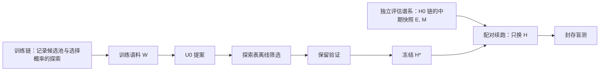

# 框架 v2 设计

本文是对 [00 研究总方案](./00%20%E7%A0%94%E7%A9%B6%E6%80%BB%E6%96%B9%E6%A1%88.md)–[02 实验协议与判定规则](./02%20%E5%AE%9E%E9%AA%8C%E5%8D%8F%E8%AE%AE%E4%B8%8E%E5%88%A4%E5%AE%9A%E8%A7%84%E5%88%99.md) 所定框架（下称 v1）的修订草案。依据是 2026-11-19 的代码核对与 Claude/Codex 交叉审查，过程见桌面《推理引擎自进化_审查与交叉核对记录_2026-11-19》。

**v2 不推倒重来。** v1 的控制器、journal、账本、配对耦合、数据分区、封存与盲评，以及第一批正确性修复（规则覆盖、D/C 整步共享、同引擎记零）都保留。v2 改两件事：**学习与使用分开**，以及**单次尝试允许自测和修正**。策略槽只登记、不提前重构。

§8 的预算上限、取点和判据是已定设计，不是实测。未锁定的参数仍待校准；本文没有 Spark 实测结果。

---

## 0. 为什么要改

v1 有三处结构局限。它们能从代码推出的，是"零结果难以定位"；推不出的，是"效应一定很小"。

| 局限 | 代码能证明的 | 代码证明不了、需上机测的 |
|---|---|---|
| H 只能重排 ≤4 个候选，条件特征在 Spark 上实际只有 gap 一个三值特征 | 策略看得少、改得少 | 真实候选池里是否经常有更好的备选 |
| 学习被限制在单次运行里：每链 ≤20 次筛选尝试，第 60 分钟 U0 只看到约 5–10 条确定性 H0 记录 | 单次运行内可摊销的窗口短（§0.1） | 短窗口内能否回本：取决于每次换选的收益，留给 RQ-B |
| 实现器单次会话，3 分钟、累计 1.35 万输入 token，不能运行引擎 | 写错一处就整次作废，没有修正机会 | 当前 Agent 是否只能做浅层优化 |

### 0.1 单次运行内学习的摊销条件（粗略模型）

设一次更新实际占掉 c 步，之后剩 k 步，新规则在比例 p 的步上改变选择、每次多带来 δ，被让出的步每步本可带来 g′。单次运行内学习净赚大致需要 `k·p·δ > c·g′`。示例假设 c≈6、k≈12 时，需要 p·δ > 0.5·g′。**这一条只针对"同一次运行里既学又用"**；对冻结策略在新运行中的效应，它不构成限制。

---

## 1. 研究问题

**主问题（RQ-A）：**

> 当两组都能继承已有引擎和实验经验时，额外继承一份从历史中学出的 Harness 策略，能否在相同的新预算内交付更快的合格引擎？

关键是"**两组都能继承**"。SEIS 已经说明固定 Agent 靠继承代码和报告就能持续改进引擎；我们要测的是在这条强基线上，H 还能增加什么，而不是再证明一次"有历史比没历史好"。

| 编号 | 问题 | 回答方式 |
|---|---|---|
| **RQ-A（主）** | 冻结的 H\* 相对 H0，在未参与训练的谱系上是否提高等预算下的交付吞吐 | §2.3 |
| **RQ-B（单次运行）** | 同一次运行里既学又用是否回本 | 保留 v1 的 RQ1，单独报告，不改名、不与 RQ-A 混算 |
| **RQ-C（成本）** | 达到同一性能目标，H\* 比 H0 实际节省多少成本；学习成本要多少次使用才收回 | §5.3 |
| **RQ-D（机制）** | 收益来自哪些状态，是否真的来自经验而非 LLM 先验 | §4 证伪对照 |

**第一主张**：等搜索预算下，冻结策略对截止时的盲测吞吐有正效应（配对区间下限 > 0），3% 作实用参考线。

注意：等预算下多交付几个百分点的吞吐，**不等于**省了几个百分点的卡时。回本要比较达到同一目标所需的实际成本（RQ-C），不能拿吞吐差直接折算。

定位不变：固定部署下的任务特定 Harness 自改进，L2；U0 固定，不做递归主张。

---

## 2. 实验结构

### 2.1 训练链

- 专门的训练链在每步以概率 ε 从池中按预登记分布随机选择，记录完整候选池与选择概率；ε 先导后定。
- **正式基线 H0 不随机化。** 探索只存在于训练链。
- 多条训练链的轨迹池化为训练语料 W，作为 U0 的输入；U0 不再只看本链最近 12 条。
- 训练阶段全部花费单列为学习成本。

### 2.2 提案与晋级（只针对排序）

排序是目前唯一开放的可学习决策（§3）。对排序，一步决策库是合适的验证工具：

- **建库**：从训练链取有 ≥2 个候选的状态，冻结父引擎、状态和候选池，按正式流程把各候选做成交付物并独立计时；差距小的候选重复实现。
- **划分**：按来源链分为探索表 L_x（可反复用）与保留表 L_h（规则冻结后才访问，每份结果只作一次新证据）。
- **边际收益** = `P(F) × E[Δ | F]`。翻转率 P(F) 用全部冻结池回放估计，条件收益只在翻转状态上测；翻转后实现或门禁失败按交付结果计入 Δ。
- **晋级门规**：保留集上翻转状态数达到预登记的 n_min，且边际收益区间下限 > 0。证据不足记"证据不足"，不晋级也不判负。

### 2.3 评估：在未参与训练的谱系上只换 H

- 评估起点取自**独立的 H0 谱系**（不进入 W、L_x、L_h）的中期快照，两臂拿到同一份引擎 E、同一份允许继承的经验 M，只换 H。
- 这样比较的是"在已有进展之上 H 还能增加什么"。只从干净 E0 重跑会让训练链已找到的可部署补丁被反复"重新发现"，高估现实中的回本机会。
- 同起点续跑沿用 v1 已实现的配对耦合：同选同执行时共享，首次分歧后各自续跑；`H*=H0` 的点贡献精确为零，并保留在分母。
- **续跑长度必须覆盖收益最早可见的步数。** 排序的收益在翻转那一步之后就可见，30 分钟级的续跑可能够用；若将来开放多步才见效的决策（§3），续跑长度要相应加长。
- 从干净 E0 起步的独立链作为补充对照保留。

---

## 3. 可学习决策：先登记，按需开放

v1 写死在控制器里的其他决策可能也值得学习：经验准入、经验检索、尝试协议、主线接纳、空池与停止。**现在只登记，不做统一的策略槽重构。**

原因是不同决策的收益出现在不同时间，不能用同一个一步结果裁决：

- **主线接纳**：允许保留一个正确但暂时慢 1% 的中间版本，第一步结束时两臂的最佳引擎完全相同，记零是对的；收益要等下一步借它完成融合才可能出现。用一步结果拒绝它，就是拿第一步的成绩裁决第二步的收益。
- **尝试协议**：若允许编译失败后修一次，两臂即使选中同一候选，执行过程也可能不同，不能再按"同首选"共享整次尝试。**能共享的是仍然相同的执行过程，不是名字相同的候选。** 耦合的判定键必须包含执行协议，而不只是候选。

每开放一个决策前，先写清两件事，答不出来就说明实验还没设计好：

1. **两臂最早在哪里可能不同？**（决定耦合在哪里断开）
2. **收益最早到哪一步才看得见？**（决定验证和续跑要走多少步）

| 决策 | 最早分歧点 | 收益最早可见 | 一步决策库是否适用 |
|---|---|---|---|
| 排序 | 选择首选候选时 | 该候选交付后 | 适用 |
| 尝试协议 | 首次执行回执出现差异时 | 本次尝试交付后 | 需按执行过程耦合，库需按协议分别建 |
| 主线接纳 | 是否保留中间版本时 | 后续一步或多步 | 不适用，需多步续跑 |
| 经验准入 / 检索 | 生成器看到的历史不同时 | 生成的候选池不同之后 | 不适用，影响候选池本身 |

下一个开放哪个决策，按"**修正哪个决策能挽回最多真实收益**"选，不按"哪个环节失败次数最多"选（§6）。

---

## 4. 单次尝试：锁定假设，不锁死步骤

- **锁定的**：本次要验证的优化假设（所选候选）。Agent 发现另一件事更值得做时，可以登记为下一候选，但不能中途换题、最后给原选择记功。
- **放开的**：可以读相关文件、改多处代码、编译、跑公开冒烟测试，依据控制器返回的开发结果修一次。
- **不回传的**：独立性能确认与封存盲测结果。测量一律由控制器执行。
- **两臂相同**：工具、回路和总预算一致。

**先在同预算下比较"有无反馈修正"，再单独试加预算。** 否则即使成功率提高，也分不清是回路有效还是花得更多。

---

## 5. 分区、统计与成本

### 5.1 分区

| 池 | 用途 | 来源与可见范围 |
|---|---|---|
| W | U0 提案输入 | 训练链轨迹 |
| L_x / L_h | 排序提案的筛选 / 晋级 | 训练链状态，按来源链划分 |
| 评估谱系 | RQ-A 的起点 E、M | 独立 H0 链；不得出现在 W、L_x、L_h |
| S/D | 公开搜索与开发请求 | Agent 可见 |
| T/Q | 封存终评 | 仅终评裁判 |

### 5.2 统计

- 独立单位是评估谱系；同谱系多个快照先平均再跨谱系估计，测量块、请求不增加样本数。
- 第一主张用配对区间下限 > 0；不再用"区间下限 > 0 且点估计 ≥ 3%"的混合判据（真实效应恰为 3% 时通过率约一半，加样本也不变）。
- 样本量用先导测得的配对差方差计算。

### 5.3 成本（RQ-C）

分开报告：学习成本（训练链、建库、复做、保留验证、U0 调用）；达到预设性能目标时 H\* 相对 H0 的实际成本差；二者之比给出回本次数。等预算吞吐差不折算成成本节省。

---

## 6. 下一笔 Spark 时间：先买两个答案

| 先导问题 | 测法 | 结果决定什么 |
|---|---|---|
| **P1：给对方向，Agent 做不做得出来？** | 用已在目标硬件和版本上验证可行、但不给补丁的任务，在同预算下对比现有实现器与短修正回路；逐题记录忠实交付、失败原因和实际成本 | 已知可行任务也频繁死在可修的小错上 → 先修执行回路，暂不训练排序器 |
| **P2：Agent 做得出来时，H0 是否经常选错，而且错得可预测？** | 抽真实 H0 候选池，空池与单候选池计入分母；对部分多候选池从同一父引擎实做备选并独立复测；比较简单动作表与读历史的 U0 在留出谱系上谁挑得更好 | 好方向没被提出 → 改生成；备选更好但特征分不出 → 改观测；只有错选有规律，才继续做排序学习 |

**顺序**：P1 在前。P2 必须用 P1 之后定下的执行器版本，否则 P1 一改执行器，P2 的备选收益就要重测。

**P1 的前置工作**：任务集本身需要先建。每项任务要有一份在 GB10 和锁定版本上验证过的参考实现（由人或一次长会话产出，不交给被测 Agent），并配若干已知不可行的任务，用来检查"假成功"。这部分的人力和卡时要单列。

---

## 7. 代码迁移计划

| 阶段 | 改动 | 验收 |
|---|---|---|
| **M0 · v1 待办** | Memory 与去重拆分；空池带排除表限次重提；预算点签名快照与封卷后重测 | 按 v1 原验收条件 |
| **M1 · 修正回路（视 P1 结果）** | 实现阶段的短修正回路；控制器回执；耦合判定键加入执行协议 | 两臂回路相同；测量只由控制器执行；执行过程不同则不共享 |
| **M2 · 训练链与倾向记录** | 训练链 ε 探索与选择概率记录；正式 H0 保持确定 | ε=0 时与 H0 逐步一致；倾向可从日志重算 |
| **M3 · 训练语料与 U0 输入** | W 构建器；U0 从 W 抽取；分区访问控制覆盖 W、L_x、L_h 与评估谱系 | U0 读不到评估谱系与 T/Q |
| **M4 · 排序决策库与新门规** | 建库、L_x/L_h 划分、边际收益估计、§2.2 门规 | mock 上对已知 P(F)、Δ 的库估计无偏；L_h 结果不能重复作新证据 |
| **M5 · 评估编排** | 训练 → 冻结 → 评估谱系配对续跑 → 封存盲测；RQ-B、RQ-C 报表 | mock 端到端可恢复；评估阶段无元更新调用 |

不做六槽统一重构。其他决策开放时，按 §3 的两个问题单独设计。

---

## 8. 已定决策（2026-11-19）

| 项目 | 决定 |
|---|---|
| 主问题与主张 | 采用 RQ-A。第一主张：等搜索预算下冻结策略对截止盲测吞吐有正效应。3% 只作参考线 |
| 判据 | 每个快照算截止盲测吞吐的 `log(T_H*/T_H0)`；两个快照在谱系内等权平均；对独立谱系的差值算双侧 95% 配对区间，下限 > 0 即成立。样本数是独立谱系数。结论**不等于**至少快 3%，也**不等于**学习已回本 |
| 评估起点 | 未参与训练的 H0 母链在预定墙钟预算 **50%、75%** 处的快照。每点取截至该时刻最后一个已完成、可恢复的 `(E, M)`，不挑晋级、翻转或已加速的快照。两点都从原母链独立分叉，75% 点不能接在 50% 点的实验臂之后。E0 起步只作补充对照；预算紧时先减 E0 对照 |
| P1 建题 | 课题负责人起草任务卡、参考实现与可重放验收脚本；由未参与建题者在锁定的 GB10、引擎提交与工作负载上独立验收。被测 Pi 用干净会话，只拿任务卡与公开开发反馈 |
| P1 题量 | 2 道正例（一项局部改动、一项跨文件配合），2 道负控（破坏语义却报成功；未改变执行路径却报提速）。正例须参考实现过质量门，且重复计时能与 E0/E0 噪声区分。参考作者没做出来不算"已知不可行" |
| P1 预算 | 建题：1 工程人日 + ≤4 GB10 节点时（止损上限，到顶仍无两道合格正例则停在建题阶段）。盲跑：≤8 节点时，4 题 × 2 种执行器 × 2 次新会话，共 16 次，含独立复核。两笔合计 ≤12 节点时，不含 P2、训练或放宽预算的第三臂 |
| P1 的定位 | 选执行器的工程试验，不估计 Agent 的普遍成功率。只看：短回路是否在同预算内救回可复现的实现失败；是否引入假成功 |
| 修正回路的实现顺序 | 先做只够对照的隔离原型；P1 后才决定是否合入；冻结版本后再跑 P2 |
| 有损轨道 | 首轮不开。将来若研究量化，另定质量终点、基线与预算，不给无损轨道补成绩 |

**P1 的复现与负控。** 每题每种执行器的两次新会话只说明该题能否复现，不是两个独立样本；按题报告，不从这 16 次运行估计成功率。建题阶段先冻结负控的预期判定和可重放脚本。“执行路径未变却报提速”须有与参考实现在同一负载上的执行路径证据（如预登记的 kernel 序列或调用计数）；只凭快慢或一次计时不能判定。

### 8.1 正式评估前的两项实施条件

以下两项保留发现时的描述供复核。`7e3f6f2` 已为 RQ-A 单独实现，v1 的 `S_dev` 曲线、D/C 建库和判据保留原义；这不是 P1 验收或实机结论。见 [RQ-A 实现](../evolveengine/rqa.py)、[55 分钟失败与报表回归](../tests/test_rqa.py)及[离线复验入口](../README.md)。

1. **墙钟 `(E, M)` 快照。** 现有预算点记录只签在任引擎（`controller.py` 中的 `admissions` 只含 `engine_digest`），建库函数按已完成步骤的位置取样（`experiment.py` 的 `build_bank`）。二者都不能原样当作 §2.3 的评估起点。需要按墙钟取"最后一个已完成、可恢复的 `(E, M)`"。回归测试：第 55 分钟有一次失败、E 未变而 M 已变时，第 60 分钟的快照两臂都应继承这条失败经验。
2. **报表判据。** `reports.py` 的 `meets_design_threshold` 仍要求点估计 ≥ 3%，不能直接用来判 RQ-A；应按上表判据单独实现，并保留 3% 参考线的读数。

### 8.2 措辞约定

预算结构决定的是"**单次运行内可摊销的窗口短**"，这是结构事实。是否真的回本还取决于每次换选的收益：如果一次换选就能避开很差的方向，短窗口也可能回本。这个问题留给 RQ-B 的实测回答，不在设计文档里预判。

### 8.3 复审后的执行队列（不是新的实机结果）

`2af59c2` 的 §8.1 离线复核通过，可以进入 [P1 建题](./06%20P1%20建题与独立验收.md)。以下是正式 RQ-A 前的事项，不是 P1 的先决条件，也不把 v1 的盲评静默换成另一种测量。

- **预算点是否真代表不同起点。** E0 校准测运行噪声与每块耗时；另用公开 H0 干跑估每步 token、初筛/复测块及预留失败情况。再冻结母链预算。逐点已有 `wall_ms`、`completed_wall_ms` 和 `source_event`；汇总增加快照年龄、两点的 E/M 是否相同、母链停止原因（含首个无法预留的操作和所有受限维度）。状态相同照实保留，不补跑到发生变化。
- **两臂直接盲评（待实现，限 RQ-A）。** 对不同的合法交付，在同一 T 块内直接测 H0/H* 交付的引擎；事前按谱系、预算点和块交错平衡 `PQQP` / `QPPQ`，用同块对数吞吐比。保留起点合法性及回退、同合法引擎精确为零、费用/断点恢复和版本隔离。当前只在每臂与起点的小组内变换顺序，不保证两臂两个整组的先后平衡。P2 开始前做漂移与恢复回归，绝不提前打开正式 Q/T。
- **缺失与重试（拟预登记）。** 依 02 区分可核实的外部中断和方法自身失败：仅外部中断允许同起点、种子、环境整对重跑一次，保留原费用与事件；若只是裁判中断，复用原封包重做整对盲评，不重搜补丁。方法自身失败依交付/回退规则处理，不能换种子重试。仍缺一点则整条谱系不进入完整谱系估计，不拿另一点补权；列全部预定谱系、原因、完整谱系区间，以及缺失谱系须有多大效应才会改变结论。暂保留“有缺失不判确认成功”，不得事后按完整样本的显著性解除；若要改判定，正式评估前另行冻结。

---

## 9. 与 v1 的对照

| 方面 | v1 | v2 |
|---|---|---|
| 主问题 | 单次运行内学习是否净赚 | 两组都继承 E、M 时，冻结 H\* 在新预算内是否交付更快的引擎；单次运行保留为 RQ-B |
| 学习数据 | 本链最近 ≤12 条、无探索 | 专门训练链池化、记录选择概率；正式 H0 不随机 |
| 评估起点 | 同一 E0 的两条主链 | 未参与训练的谱系的中期快照，两臂同 E、同 M，只换 H |
| 可学习决策 | 只有排序 | 只有排序；其余登记，按"最早分歧点、收益最早可见步"逐个设计 |
| 晋级 | 两个一步 D 点都 > 0 且均值 ≥ 2% | 保留集上边际收益区间下限 > 0，且达到最低证据量（仅适用于排序） |
| 单次尝试 | 一次会话、不能运行引擎 | 锁定假设、可自测和修正一次；先同预算对比，再试加预算 |
| 成本口径 | 元更新从同一预算里扣 | 学习成本单列；回本按达到同一目标的实际成本差计算 |
| 保留不变 | journal、账本、配对耦合、分区、封存、盲评、同引擎记零 | 同左 |
